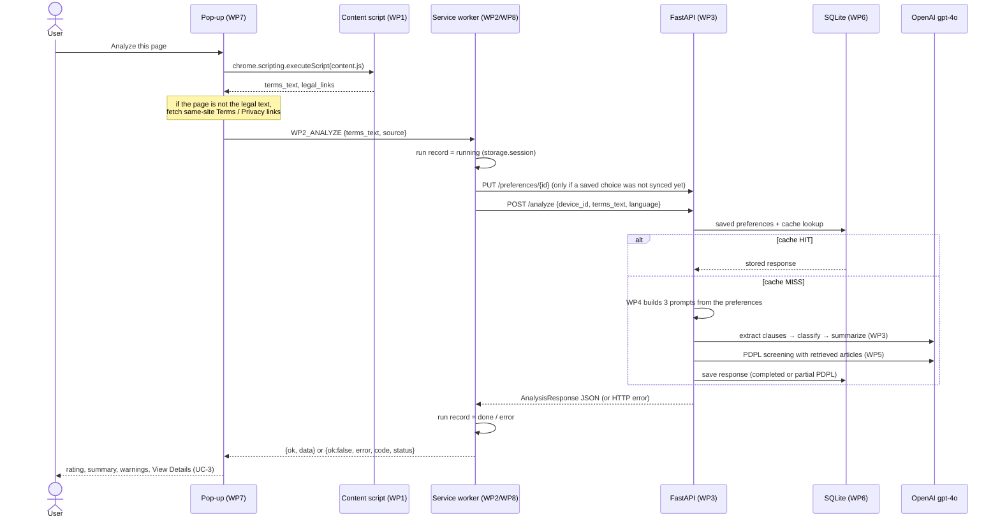

# WP8 — System Integration and End-to-End Testing

**Project:** Aamen (آمن)  
**Work Package:** WP8 — Integration of all components into one system (all use cases)  
**Responsible:** Ahmed Abukadra  
**Branch:** `feature/wp8-integration` (based on `feature/wp7-popup`, commit `3363ff1`)  
**Date:** 2026-11-10  
**Model:** OpenAI `gpt-4o-2024-08-06` (the backend default)  
**Environment:** Windows 11, Python 3.12.3 (venv), fastapi 0.162.0, uvicorn 0.54.0, openai 3.48.0, pydantic 2.14.3, httpx 0.28.1, Node.js 20.15.0, Chromium 158 via Playwright 1.65.0  
**Evidence:** screenshots in [`screenshots/`](screenshots/) (`WP8-E2E-*.png`), logs and raw results in [`wp8_logs/`](wp8_logs/)

## 1. Scope

The Implementation Plan defines WP8 as: *integrate all components and resolve interface issues between them*,
with the deliverable *an end-to-end flow from opening a T&C page to displaying the results*. WP1–WP7 were each
built and tested on their own branches. WP8 joins them on one branch, finds where the pieces do not fit, fixes
those places, and tests the whole system with the real model in a real browser.

| Component | Work package | Integrated through |
|---|---|---|
| Content script (`extension/content.js`) | WP1 | Injected by the popup; result passed to the service worker |
| Service worker (`extension/background.js`) | WP2 | Messages from the popup; HTTP to FastAPI |
| Backend + AI pipeline (`backend/main.py`, `backend/analysis/`) | WP3 | `POST /analyze` |
| Prompt adjuster (`backend/prompt_adjuster/`) | WP4 | Preferences loaded from the WP6 database |
| PDPL checker (`backend/pdpl/`) | WP5 | `pdpl` field of the analysis response |
| Database, preferences, cache (`backend/database/`) | WP6 | `/preferences/{device_id}`, cache in `/analyze` |
| Pop-up interface (`extension/popup.*`, `ui-strings.js`) | WP7 | All of the above |

### Files changed by WP8

| File | Owner WP | Change |
|---|---|---|
| `extension/background.js` | WP2 | Preference saving (`WP8_SAVE_PREFERENCES`), error codes, 150 s timeout with keep-alive, run record, sender check |
| `extension/popup.js` | WP7 | Save / Undo for preferences, unsaved-changes notice, error codes, restoring a run, 3 new error screens (EN + AR) |
| `extension/popup.css` | WP7 | Styles for the save bar, warning message and disabled buttons |
| `extension/manifest.json` | WP2 | Host permission for the local backend, description, version 1.1.0 |
| `backend/database/cache.py` | WP6 | Cache results whose PDPL status is `partial` (W8-09) |
| `tests/test_wp6_cache.py` | WP6 | Two tests use `unavailable` instead of `partial` for the "not cached" case (same intent, updated rule) |
| `tests/test_wp8_integration.py`, `tests/wp8_js/`, `tests/wp8_e2e/`, `run_wp8_tests.py` | WP8 | New tests |
| `docs/WP8-integration.md`, `README.md` | WP8 | This report and the run guide |

No WP3, WP4 or WP5 source file was changed, and no existing API field or endpoint was removed or renamed.

## 2. Integrated data flow

## 3. Interface contract

### 3.1 Pop-up → service worker messages

Messages are accepted only from the extension's own pages (`sender.url` starts with the extension URL).
Websites and content scripts cannot send them.

| Type | Payload | Success `data` |
|---|---|---|
| `WP2_CHECK_CONNECTION` | none | `/health` response |
| `WP2_ANALYZE` | `terms_text`, `language`, `page_url`, `page_title`, `source {kind, url, title}` | `AnalysisResponse` |
| `WP8_SAVE_PREFERENCES` | `accepted {location, photos, banking_information, third_party_sharing}` (booleans) | `{accepted, synced}` (+ `error`, `code` when `synced` is false) |

Every failure is `{ ok: false, error, code, status }`. `error` keeps the old English text, so older code still works.

### 3.2 Service worker → backend

| Method | Endpoint | Used when | Timeout |
|---|---|---|---|
| GET | `/health` | Server settings → Check connection | 20 s |
| PUT | `/preferences/{device_id}` | Save preferences; or before the next analysis if the last save could not reach the server | 20 s |
| POST | `/analyze` | Every analysis. The body has no `preferences`: the backend reads the saved ones from WP6, as the WP4 contract asks | 150 s, keep-alive every 20 s |

### 3.3 Response fields the pop-up reads

`flagged_clauses[]` (`clause_id`, `category`, `severity`, `source_excerpt`, `explanation_en/ar`), `summary_en/ar`,
`risk_score` / `risk_level` (recomputed in the pop-up with the same formula, see W8-11), `input_truncated`,
`disclaimer`, and `pdpl` (`status`, `findings[]` matched to clauses by `clause_id`, `legal_references[]` with
`title`, `article_id`, `excerpt`, `source_url`). `test_wp8_integration.py` checks every one of these.

### 3.4 Error codes

| Code | Comes from | Pop-up screen (EN) |
|---|---|---|
| `server_unreachable` | network error | Can't reach the server + Open server settings |
| `permission` | no host permission / bad server address | Server access not allowed + Open server settings |
| `timeout` | no answer within 150 s, or HTTP 504/408 | The analysis took too long *(new)* |
| `ai_not_configured` | 503 "…not configured…" | Analysis isn't set up yet |
| `storage_unavailable` | 503 "Preference storage is unavailable." | Preferences could not be loaded *(new)* |
| `no_clauses` | 502 "No source-grounded clauses…" | No clear clauses found + Paste text instead |
| `ai_unavailable` | other 502, any 500 | Analysis service unavailable |
| `too_short` | text outside 50–120,000 characters, or 422 about `terms_text` | Not enough text + Paste text instead |
| `bad_request` | other 4xx | Something went wrong (shows the server's message) |
| `interrupted` *(pop-up only)* | the service worker stopped before answering | The analysis was interrupted *(new)* |

Errors detected in the pop-up itself are unchanged: `offline`, `not_web`, `no_text`, `bad_result`.

## 4. Preferences: meaning and storage (resolves I-09)

Senior Project I describes preferences as *"whether the user is comfortable sharing photos, banking information,
or location"* (class diagram: `allowLocation`, `allowPhotos`, …). The WP7 pop-up follows this and asks
**"What do you accept?"**. WP4 and WP6 store the opposite view: `true` = *give this topic extra attention*.
WP4 already logged this as issue I-09 and proposed the mapping used here:

| Pop-up (WP7) | Stored in WP6 and used by WP4 | Effect |
|---|---|---|
| Don't accept | `true` (extra attention) | The prompts prioritize this topic; its clauses count at full weight in the user's rating |
| Accept | `false` | No extra attention; its clauses count one level lower in the user's rating (WP7 rule) |
| Never saved | no row → WP6 defaults (all `false`) | UC-1 alternate course 1: default settings |

UC-1 steps now match the design: the user changes the switches (the rating updates as a preview), presses
**Save preferences** (stored on the device and in the database), and *exiting without saving does not update
anything*. If the server cannot be reached the choice is kept on the device and sent before the next analysis.

## 5. Issues found and fixed

| ID | Issue | Found in | Severity | Status | Fix |
|---|---|---|---|---|---|
| W8-01 | Pop-up preferences were never sent to WP6, so WP4 personalization never ran from the extension | Code review | High | Fixed | `WP8_SAVE_PREFERENCES` → `PUT /preferences/{device_id}` |
| W8-02 | Preference meaning differs between WP7 (accept) and WP4/WP6 (attention) — I-09 | Code review | Medium | Fixed | Mapping in section 4 |
| W8-03 | Preferences saved on every click; UC-1 needs Save and "exit without saving → no update" | Code review | Medium | Fixed | Save / Undo bar, unsaved-changes notice |
| W8-04 | Errors reached the pop-up as English sentences; 502 classifier omission, 503 storage, 422 lists and timeouts showed "Something went wrong" or the wrong screen, in English even in the Arabic UI | Code review | Medium | Fixed | `code` + `status` on every error, 3 new EN/AR screens |
| W8-05 | 55 s request limit is shorter than the backend's worst case (4 model calls × 45 s, with retry) | Code review | Medium | Fixed | 150 s limit, service-worker keep-alive |
| W8-06 | Closing the pop-up during an analysis (it closes on any click outside it) lost the result | Code review | Medium | Fixed | Run record in `chrome.storage.session`, restored when the pop-up opens |
| W8-07 | The default server `http://127.0.0.1:8000` needed a manual permission step before the first analysis | Code review | Low | Fixed | `host_permissions` for 127.0.0.1 and localhost |
| W8-08 | The service worker ignored `popup.html` opened in a tab (`sender.tab` check), which blocks testing and full-tab use | E2E setup | Low | Fixed | Check the sender URL instead (still never websites) |
| W8-09 | Real pages always have clauses without a PDPL article (liability, changes to terms) → PDPL `partial` → WP6 never cached them; every repeat cost a full analysis | E2E run 1 (9/11) | Medium | Fixed | Cache `completed` and `partial`; repeat analysis now 0.1 s instead of ~20 s |
| W8-10 | `language` is part of the cache key although the response has both languages, so switching language and analyzing again runs a new analysis | Review | Low | Open | WP6/WP3: drop `language` from the key or from the request |
| W8-11 | The pop-up has its own copy of the rating formula (`backendRating`) | Review | Low | Guarded | `test_14` compares it with `rating.py` for 343 severity mixes |
| W8-12 | First analysis still takes 9–21 s (requirement: "a few seconds") | E2E | Medium | Partly addressed | Cache now works (0.1 s on repeat); clear loading screen; result kept if the pop-up closes |

### Inherited issues

| ID (WP4 log) | Status after WP8 |
|---|---|
| I-07 Analysis time | Re-measured with OpenAI: 9.0–20.8 s per fresh analysis (mean 17.4 s, 5 runs, 4 model calls each); cache hit 0.1 s. See W8-09 and W8-12 |
| I-09 Preference names and meaning | Resolved by the mapping in section 4 |
| I-10 No `.gitignore` | Already resolved by WP6; checked: `.env`, `.venv/`, `__pycache__/`, `*.sqlite3` are ignored |
| I-02, I-03, I-08 | Unchanged (WP3 items, outside integration) |

## 6. Test cases

### WP8-TC01 — Regression of earlier work packages

**Procedure:** Run `python run_wp8_tests.py` (no API key set).  
**Expected:** All WP4, WP5 and WP6 tests still pass after integration.  
**Actual:** All 50 earlier tests pass. Two WP6 cache tests were updated for W8-09: they now use `unavailable` as the
"not cached" example instead of `partial`.  
**Result:** PASS  
**Evidence:** `wp8_logs/offline_tests.log`

### WP8-TC02 — Backend integration through HTTP (offline)

**Procedure:** `tests/test_wp8_integration.py`, 15 tests. The four model calls are replaced by a fake model that
returns the real Pydantic schemas, so FastAPI → WP6 → WP4 → WP3 → WP5 → WP6 run for real without OpenAI.  
**Expected:** The response has every field the pop-up reads; saved preferences reach all three WP4 prompts; the
cache gives MISS → HIT → MISS after a preference change and also caches `partial` PDPL results; each backend error
has the status and message the service worker maps; limits and field names are the same on both sides; the
pop-up's rating equals `rating.py`.  
**Actual:** `Ran 65 tests … OK` (50 earlier + 15 WP8), 0 skipped.  
**Result:** PASS  
**Evidence:** `wp8_logs/offline_tests.log`

### WP8-TC03 — Service worker (offline)

**Procedure:** `node --test tests/wp8_js/` (18 tests). `background.js` runs with a fake `chrome` API and `fetch`.  
**Expected:** Correct preference mapping and `PUT`; offline save then sync before the next analysis; `/analyze`
body unchanged (no `preferences`); 150 s timeout; every error mapped to the right code; run record written and not
overwritten by an older run; messages from websites or other extensions ignored.  
**Actual:** `# tests 18 # pass 18 # fail 0`.  
**Result:** PASS  
**Evidence:** `wp8_logs/offline_tests.log`

### WP8-TC04 — Live end-to-end in the browser

**Procedure:** `python tests/wp8_e2e/run_e2e.py` with the real API key. Chromium with the unpacked extension, the real
backend with a new database, and a fictional website (see `tests/wp8_e2e/README.md`). Run window
2026-11-10 02:44:35 – 02:46:23 +0300.  
**Expected:** Every use case and alternate course works from the pop-up.  
**Actual:** **11 / 11 scenarios passed.** The first run gave 9/11 and found W8-09; after the fix all passed.

| ID | Scenario | Use case | Actual | Result | Evidence |
|---|---|---|---|---|---|
| E2E-01 | Check connection with the default server | Integration | "Connected to the Aamen server.", no permission prompt | PASS | `WP8-E2E-01-connection.png` |
| E2E-02 | Analyze an open Terms page | UC-2 | Result in 19.9 s: safety 10/100, High risk, 6 warnings; result cached | PASS | `WP8-E2E-02-terms-summary.png`, `-02-warning-open.png` |
| E2E-03 | View Details | UC-3 | Report with 6 clauses and 9 PDPL references with official links; Esc closes it | PASS | `WP8-E2E-03-report.png`, `-03-report-pdpl.png` |
| E2E-04 | Homepage with legal links | UC-2 | Followed the Terms and Privacy links; analyzed both in 18.4 s: High risk, 7 warnings | PASS | `WP8-E2E-04-homepage.png` |
| E2E-05 | Save preferences | UC-1 | Accepted photos + banking, saved. `GET /preferences` = `{"location": true, "photos": false, "banking_information": false, "third_party_sharing": true}` | PASS | `WP8-E2E-05-prefs-unsaved.png`, `-05-prefs-saved.png` |
| E2E-06 | Exit without saving | UC-1 alt. 2 | Location changed, pop-up closed, reopened: still "Don't accept"; server unchanged | PASS | `WP8-E2E-06-exit-without-saving.png` |
| E2E-07 | Preferences used in the next analysis; cache | UC-1 step 5, WP6 | New analysis (cache MISS) in 20.8 s, "Your choices changed the rating by 5 points"; same page again: cache HIT in 0.1 s | PASS | `WP8-E2E-07-personalized.png` |
| E2E-08 | Pop-up closed during an analysis | Integration | Reopened 2 s later: loading screen, then the result for "Privacy Policy — Rihla Delivery" (Moderate, 4 warnings) | PASS | `WP8-E2E-08-reopened-loading.png`, `-08-restored-result.png` |
| E2E-09 | Arabic interface, pasted text (DOC-C) | UC-2 manual paste | متوسط (Moderate), ٨ تحذيرات (8 warnings) in 18.8 s; layout right-to-left | PASS | `WP8-E2E-09-arabic-paste.png`, `-09-arabic-report.png` |
| E2E-10 | Error messages | UC-2 alt. 1–3 | Server down → "Can't reach the server"; no API key → "Analysis isn't set up yet" / "التحليل غير مفعّل بعد"; short text → "Add at least 50 characters…"; no legal text → "No legal text found" + paste; offline → "No internet connection" | PASS | `WP8-E2E-10a…10e-*.png` |
| E2E-11 | Preferences saved while the server is down | UC-1 | "Saved on this device…"; sent before the next analysis (location `true` → `false`), then analyzed in 9.0 s | PASS | `WP8-E2E-11-saved-locally.png` |

**Result:** PASS  
**Evidence:** `wp8_logs/e2e_results.json`, `wp8_logs/e2e_console.log`, `wp8_logs/e2e_backend.log`,
`wp8_logs/e2e_backend_no_key.log`, `screenshots/WP8-E2E-*.png`

**Note:** Chrome opens the real pop-up only from the toolbar button, so the test opens `popup.html` as a tab and a
test-only script points `chrome.tabs.query` at the fixture tab. The extension code itself is not changed.

## 7. How to run

See the root [`README.md`](../README.md) for installing and running the system, and
[`tests/wp8_e2e/README.md`](../tests/wp8_e2e/README.md) for the browser test.

## 8. Handoff to WP9 and WP10

- **WP9:** `run_wp8_tests.py` runs all offline checks in one step; `tests/wp8_e2e/run_e2e.py` repeats the live
  scenarios. Open items for testing and evaluation: W8-10, W8-12 and the WP3 items I-02, I-03, I-08.
- **WP10:** sections 2 (data flow), 3 (interfaces), 4 (preferences) and the screenshots can be used directly in the
  final report.
- **Merging:** this branch contains WP7 (`feature/wp7-popup`), which is not merged into `main` yet. Merge WP7 first,
  or merge this branch, which includes it.
